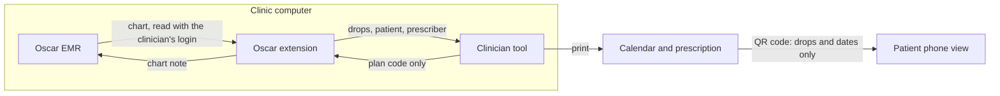

# Eye Drop Tracker

Eye care teams use this free, open-source tool to turn a drop regimen into a printed calendar, a prescription and phone reminders, all from one entry.

[eyedroptracker.com](https://eyedroptracker.com) · Apache 2.0 · Yusuf Ahmed and Fahad Butt

Adherence to glaucoma and post-operative drops is poor, and complex regimens (several drops, different eyes, tapers) are a common source of error. The prescriber enters the regimen once. The patient gets a calendar with a tick box for every dose, a prescription with the sig written out in full, and a phone view with a daily checklist and reminders.

## What is in this repository

| Part | What it is | Where |
| --- | --- | --- |
| Website | The clinician tool and the patient phone view, a React single-page app with no server | `src/` |
| Phone app | The patient view wrapped with Capacitor for iOS and Android, adding dose notifications | `android/`, `ios/` |
| Oscar extension | A Chrome extension that reads the drops from an Oscar EMR chart and writes the plan back | `oscar/extension/` |

## Quick start

Needs Node 22 (see `.nvmrc`).

```bash
npm install
npm run dev          # the site at http://localhost:5173
npm test             # unit tests
```

## How it works



- **No server.** Patient details live in the open browser tab and are cleared after 30 minutes idle or on New patient. Formulary edits and prescriber details stay in that browser.
- **The phone link carries the plan only.** The QR code and link hold the drugs, eyes, doses and dates in the URL fragment, which browsers never send to a server. They never hold a name, date of birth, health card number or address.
- **Everything from outside is checked.** Links, imported formularies, stored data and data from the extension are validated and size-limited before use (`src/lib/validate.js`, `src/app/clinician/state.js`).
- **One model drives every output.** The calendar, prescription, phone view, alarms and chart note are all built from the same drop model (`src/lib/regimen.js`, `src/lib/doses.js`), so they always agree.

## Project layout

```
src/
  main.jsx                  entry point, service worker
  config.js                 name, owners, contact, terms version
  app/                      the shells around the pages
    App.jsx                 root: patient side for plan links, clinician side otherwise
    Layout.jsx              header, footer, skip link
    ErrorBoundary.jsx       a way back after an unexpected error
    clinician/              the three-step visit, its state, prescriber and formulary hooks
    patient/                plan links, the app welcome, damaged links
  components/               pages and parts, grouped by step
    drops/                  step 1: patient, drop list, drug search, tapers, Oscar review
    schedule/               step 2: month calendar, daily chart, checklist, legend
    rx/                     step 3: prescription form, sheet, signature
    formulary/              the clinic's drug list
    patient/                phone view, reminders, install tip
    ui.jsx                  shared small pieces
  hooks/                    React hooks: stored state, idle clearing, QR code, clock, Oscar bridge
  lib/                      plain logic with no React, all unit tested
    regimen.js              the drop model and doses per day
    doses.js                doses grouped by time for the phone, alarms and notifications
    wording.js              prescription sig and plain-language instructions
    checks.js               safety checks: duplicate therapy, label maximum, beta blockers
    share.js                phone link encoding and decoding
    noteParser.js           reads drops from free-text clinic notes
    validate.js             checks on links, files and stored data
    native.js               the only file that talks to the phone app
  data/                     default formulary, cautions, drop forms
oscar/
  extension/                the Chrome extension (Manifest V3)
  standin/                  a stand-in Oscar with made-up patients, for testing
  tests/                    browser suites run against the stand-in
tests/                      unit tests and note fixtures
scripts/                    build, release and benchmark tools
public/                     legal pages, icons, manifest, service worker
docs/                       guides: Oscar, release, store listing, reader accuracy, legal
store/                      app store and Chrome Web Store assets
```

## Scripts

| Command | What it does |
| --- | --- |
| `npm run dev` | Site with hot reload on port 5173 |
| `npm run build` | Production build in `dist/`, with the open source licence list |
| `npm test` | Unit tests (Node test runner) |
| `npm run test:oscar` | Builds the site and extension, starts the stand-in Oscar, runs every browser suite. Name suites to run only those: `npm run test:oscar -- edge eyeform` |
| `npm run check` | Lint, formatting, unit tests and browser suites, as CI runs them |
| `npm run lint`, `npm run format` | ESLint, and Prettier to format |
| `npm run ext:build -- --oscar=<origin>` | Builds the extension for one clinic's Oscar address. `--dev` adds localhost |
| `npm run reader:bench`, `reader:score` | Accuracy of the note reader on the fixtures in `tests/fixtures/` |
| `npm run app:ios`, `app:android` | Builds and opens the phone app in Xcode or Android Studio |

The browser suites need Chromium once: `npx playwright install chromium`.

## Testing

- **Unit tests** (`tests/`) cover dosing, tapers, wording, dose times, alarms, links, validation, safety checks and the note reader.
- **Browser suites** (`oscar/tests/`) run the built extension in Chrome against the stand-in Oscar: the full visit end to end, 18 security and privacy checks, 21 clinic edge cases, the ophthalmology Eye Form and window types, a differing Oscar build, and the address lock.
- **CI** (`.github/workflows/ci.yml`) runs lint, formatting, unit tests and the build on every push to `main` and every pull request. It also runs the browser suites without blocking, since Chrome on GitHub's runners loses track of new tabs. Run `npm run test:oscar` locally before each release.

Only made-up patients are used in tests and development. Never develop against a live chart.

## Deployment

- **Website:** Vercel deploys `main` automatically. `vercel.json` sets the security headers (content security policy, no framing, no referrer).
- **Phone app:** see [docs/RELEASE.md](docs/RELEASE.md).
- **Oscar extension:** see [docs/OSCAR.md](docs/OSCAR.md) and [docs/CHROME_STORE.md](docs/CHROME_STORE.md). The extension version is `extensionVersion` in `package.json`.

## Documentation

| Guide | Covers |
| --- | --- |
| [docs/FEATURES.md](docs/FEATURES.md) | Everything the website and phone app do, privacy and accessibility |
| [docs/OSCAR.md](docs/OSCAR.md) | How the extension works, its safeguards, testing and clinic installs |
| [docs/RELEASE.md](docs/RELEASE.md) | Releasing the iOS and Android apps |
| [docs/CHROME_STORE.md](docs/CHROME_STORE.md) | The Chrome Web Store listing and permissions |
| [docs/reader-accuracy.md](docs/reader-accuracy.md) | How well the note reader reads real-world notes |
| [docs/legal/](docs/legal/) | Privacy impact assessment, clinical safety case, legal register |
| [CONTRIBUTING.md](CONTRIBUTING.md) | Branches, commits and code conventions |
| [CHANGELOG.md](CHANGELOG.md) | What changed in each release |
| [SECURITY.md](SECURITY.md) | How to report a vulnerability |
| [CODE_OF_CONDUCT.md](CODE_OF_CONDUCT.md) | How we work together |

## Clinical disclaimer

This is a clinical aid. It does not replace clinical judgement. Check every prescription and calendar before it goes to a patient. Cap colours follow the American Academy of Ophthalmology class convention and are shown as the usual colour, since pharmacies may dispense generics with different caps. LU codes refer to the Ontario Drug Benefit program.

## Contact and licence

eyedroptracker@gmail.com. Licensed under the Apache License 2.0, see [LICENSE](LICENSE) and [NOTICE](NOTICE).
